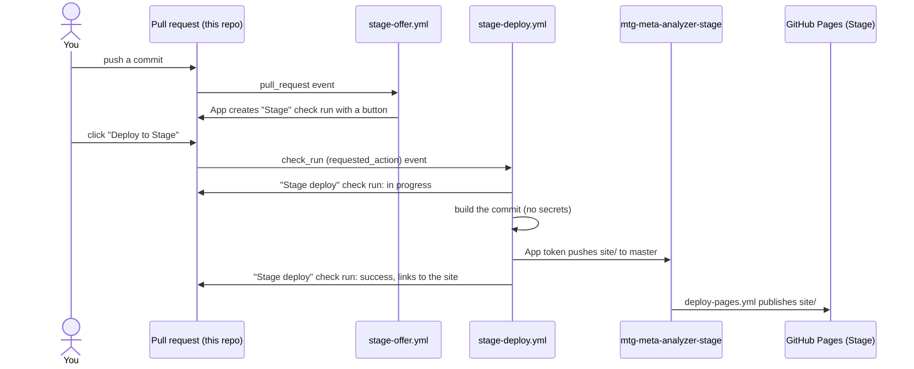

# Stage environment

Any pull request commit can be published to a separate **Stage** site,
<https://ziqul.github.io/mtg-meta-analyzer-stage/>, by clicking a
**Deploy to Stage** button on the PR. Production
(<https://ziqul.github.io/mtg-meta-analyzer/>) is untouched: it still deploys
from `master` through `deploy-pages.yml`.

The button and the push to the Stage repo both work through a **GitHub App**.
This page explains what that is, how the pieces fit together, and how to set it
up.

## GitHub Apps in five minutes

A GitHub App is an identity of its own, not a person. You register it once, and
then:

- **Permissions** are chosen when you register it (for example *Checks: read &
  write*), and it can never do more than that.
- **Installations** decide *where* it may use them. You install it on an account
  and pick repositories; it has no access anywhere else.
- **A private key** (a `.pem` file you download) proves you are the App. Code
  holding the key signs a short-lived JWT, and trades that with GitHub for an
  **installation access token**. The token is what makes API calls and git
  pushes, and it **expires after one hour**.
- **A bot account**, `<app-slug>[bot]`, is how the App shows up: as the author
  of its check runs and commits.
- **A webhook** is optional. Apps that run on a server receive events through
  it; this one doesn't need one, because GitHub Actions does all the work.

In a workflow, `actions/create-github-app-token` does the JWT-for-token trade.
You give it the App's client ID and private key, and can narrow the token to
fewer repositories and permissions than the App has, so each job gets only what
it needs.

### Why an App, and not GITHUB_TOKEN or a personal token?

1. **The button needs it.** Buttons on a check run (the Checks API's
   *requested actions*) are clicked by people, and GitHub reports the click as
   a `check_run` event with `action: requested_action`. GitHub starts **no
   workflows** for clicks on check runs created by GitHub Actions itself, so a
   check run made with `GITHUB_TOKEN` would have a button that does nothing. A
   check run created by a different App does start them.
2. **`GITHUB_TOKEN` can't reach another repository.** It only covers the repo
   the workflow runs in.
3. **Its pushes start workflows.** A push made with `GITHUB_TOKEN` never
   triggers other workflows (to prevent loops). A push made with an App token
   does, which is how the Stage repo's Pages deploy starts.
4. **No long-lived credential in the token.** A personal access token belongs
   to your account and keeps working until it expires; a deploy key never
   expires. App tokens last an hour and can be narrowed per job.

## How it works

**`.github/workflows/stage-offer.yml`** runs on every PR commit. It mints an App
token with `checks: write` and creates a check run named **Stage** on the
commit: completed, conclusion *neutral* (grey, never blocks merging), with one
button. GitHub only shows buttons on completed check runs.

**`.github/workflows/stage-deploy.yml`** runs on the click, in four jobs:

| Job | Token | What it does |
|-----|-------|--------------|
| `start` | App: `checks: write` | Checks the click came from our App's check run and from someone with write access, then creates a **Stage deploy** check run in progress |
| `build` | `GITHUB_TOKEN`: `contents: read` | Checks out the commit, `bun run build` with `BASE_PATH=/mtg-meta-analyzer-stage`, uploads `build/` as an artifact |
| `publish` | App: `contents: write`, Stage repo only | Commits the artifact as `site/` on the Stage repo's `master` and force-pushes |
| `finish` | App: `checks: write` | Marks **Stage deploy** success, failed or cancelled; on success its *Details* link opens the Stage site |

**`deploy-pages.yml` in the Stage repo** runs on every push that changes
`site/`, and publishes it with the same `upload-pages-artifact` /
`deploy-pages` pair production uses.

### Design notes

- **The build job holds no secrets.** `bun install` and `vite build` run the
  PR's code. Keeping the App key out of that job means the code being tested
  can't push anywhere. The job that pushes runs none of the PR's code.
- **Two checks on the click.** Any App installed on this repo could create a
  check run with a `deploy-stage` button of its own, so `start` only accepts
  clicks on check runs whose `app.id` matches ours. And since the click *is*
  the approval, `start` also asks GitHub what access the person who clicked has,
  and stops unless it's write or higher.
- **The Stage repo's `master` is its own files plus one deploy commit.** Each
  deploy builds on the last commit that isn't a deploy (deploy commits carry a
  `Stage-Deploy:` trailer) and force-pushes. The repo stays the size of one
  build (~410 MB, mostly `data/`), and its own files (workflow, README,
  `CLAUDE.md`) survive. Because the diff never touches `.github/workflows`, the
  App doesn't need the sensitive *Workflows* permission. A plain orphan commit
  would look like it re-adds the workflow file. Exception: if a change to the
  Stage repo is merged while a deploy commit is on top, that one old build
  stays in history.
- **`check_run` workflows run from `master`.** Like `schedule` and
  `workflow_dispatch`, a `check_run` event uses the workflow file on the default
  branch, not the PR's copy. Changes to `stage-deploy.yml` only take effect
  once they're merged, and the button does nothing until this file is on
  `master`.
- **Last click wins.** A new click cancels a deploy still in progress, in both
  repos.

## One-time setup

### 1. Register the App

On GitHub: your avatar → **Settings** → **Developer settings** →
**GitHub Apps** → **New GitHub App**.

- **GitHub App name:** anything unique on GitHub, e.g. `ziqul-stage-deployer`.
- **Homepage URL:** `https://github.com/ziqul/mtg-meta-analyzer`.
- **Webhook:** untick **Active**. There's no server to receive events.
- **Repository permissions:**
  - **Checks:** Read and write (create the button and status check runs)
  - **Contents:** Read and write (push to the Stage repo)
  - **Metadata:** Read-only (selected automatically)
- **Where can this GitHub App be installed?** Only on this account.

Click **Create GitHub App**. On the page that follows, note the **App ID** and
the **Client ID**, then under **Private keys** click **Generate a private key**.
A `.pem` file downloads; treat it like a password.

> An App's permissions apply to every repository it is installed on, so this
> App *could* write contents to the main repo too. The workflows never ask for
> that: each token is narrowed to what its job needs. For a hard guarantee,
> register two Apps (one with Checks for this repo, one with Contents for the
> Stage repo).

### 2. Install it

On the App's page: **Install App** → your account → **Only select
repositories** → choose both `mtg-meta-analyzer` and `mtg-meta-analyzer-stage`.

### 3. Give this repo the App's credentials

In `mtg-meta-analyzer`: **Settings** → **Secrets and variables** → **Actions**.

- **Variables** tab → `STAGE_APP_CLIENT_ID` = the Client ID (starts with `Iv`).
- **Variables** tab → `STAGE_APP_ID` = the App ID (a number).
- **Secrets** tab → `STAGE_APP_PRIVATE_KEY` = the whole contents of the `.pem`
  file, including the `-----BEGIN` and `-----END` lines.

The IDs aren't secret, so they go in variables, which stay readable in logs.
Until `STAGE_APP_CLIENT_ID` exists, `stage-offer.yml` is skipped rather than
failing.

### 4. Turn on Pages for the Stage repo

In `mtg-meta-analyzer-stage`: **Settings** → **Pages** → **Source**:
**GitHub Actions**. The repo must be public on a free plan.

### 5. Try it

1. Make sure `stage-deploy.yml` is on `master` (see the design note above).
2. Open a pull request, or push to one. The **Stage** check appears in the
   PR's checks list.
3. Click its **Details** link, or open the PR's **Checks** tab and select
   **Stage**. **Deploy to Stage** is the button at the top right.
4. A **Stage deploy** check appears and runs. When it turns green, its
   **Details** link opens the Stage site; the Pages deploy in the Stage repo
   takes another minute or two.

## Troubleshooting

- **No Stage check on the PR.** Check that `STAGE_APP_CLIENT_ID` is set and the
  PR comes from a branch in this repo, not a fork. A failed **Stage Offer** run
  in the Actions tab usually means a wrong key or an App not installed here.
- **Clicking the button does nothing.** Check that `stage-deploy.yml` is on
  `master` and `STAGE_APP_ID` matches the App ID. A run with its jobs skipped
  in the **Stage Deploy** workflow means the App ID check didn't match.
- **`publish` fails with 403 or "Repository not found".** The App isn't
  installed on `mtg-meta-analyzer-stage`, or it lacks *Contents: write*. If you
  change an App's permissions after installing it, accept the new permissions
  on the installation page.
- **The push went through but the Stage site didn't change.** Look at the
  Stage repo's Actions tab. Pages must be set to **GitHub Actions** (step 4).
