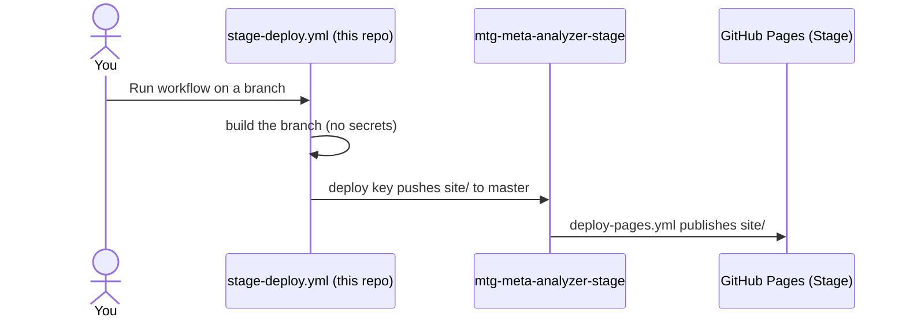

# Stage environment

Any branch can be published to a separate **Stage** site,
<https://ziqul.github.io/mtg-meta-analyzer-stage/>, by running the
**Stage Deploy** workflow by hand. Production
(<https://ziqul.github.io/mtg-meta-analyzer/>) is untouched: it still deploys
from `master` through `deploy.yml`.

## Deploying to Stage

1. In this repo, open **Actions** → **Stage Deploy** → **Run workflow**.
2. Pick the branch to deploy under **Use workflow from**, and click
   **Run workflow**.
3. When the run finishes, its summary links to the Stage repo's Pages deploy
   and to the site. The Pages deploy takes another minute or two.

GitHub only lets people with write access to the repo run workflows by hand,
so running it is the approval.

## How it works



**`.github/workflows/stage-deploy.yml`** runs in two jobs:

| Job | Credential | What it does |
|-----|------------|--------------|
| `build` | `GITHUB_TOKEN`: `contents: read` | Checks out the branch, `bun run build` with `BASE_PATH=/mtg-meta-analyzer-stage`, uploads `build/` as an artifact |
| `publish` | `STAGE_DEPLOY_KEY` | Commits the artifact as `site/` on the Stage repo's `master` and force-pushes |

**`deploy-pages.yml` in the Stage repo** runs on every push that changes
`site/`, and publishes it with the same `upload-pages-artifact` /
`deploy-pages` pair production uses.

### Design notes

- **A deploy key, not `GITHUB_TOKEN`.** `GITHUB_TOKEN` only covers the repo the
  workflow runs in, and a push made with it never starts other workflows. A
  deploy key is an SSH key that can write to the Stage repo and nothing else,
  and its pushes do start the Stage repo's Pages deploy.
- **The build job holds no secrets.** `bun install` and `vite build` run the
  branch's code. Keeping the deploy key out of that job means the code being
  built can't push anywhere. The job that pushes runs none of the branch's
  code.
- **The Stage repo's `master` is its own files plus one deploy commit.** Each
  deploy builds on the last commit that isn't a deploy (deploy commits carry a
  `Stage-Deploy:` trailer) and force-pushes. The repo stays the size of one
  build (~410 MB, mostly `data/`), and its own files (workflow, README,
  `CLAUDE.md`) survive. Exception: if a change to the Stage repo is merged
  while a deploy commit is on top, that one old build stays in history.
- **Last run wins.** A new run cancels a deploy still in progress, in both
  repos.

## One-time setup

### 1. Create a deploy key

Generate an SSH key pair with no passphrase, anywhere outside a repo:

```bash
ssh-keygen -t ed25519 -N "" -C "mtg-meta-analyzer stage deploy" -f stage-deploy-key
```

This writes `stage-deploy-key` (private) and `stage-deploy-key.pub` (public).

### 2. Give the public key write access to the Stage repo

In `mtg-meta-analyzer-stage`: **Settings** → **Deploy keys** →
**Add deploy key**. Paste the contents of `stage-deploy-key.pub` and tick
**Allow write access**.

### 3. Give the private key to this repo

In `mtg-meta-analyzer`: **Settings** → **Secrets and variables** → **Actions**
→ **Repository secrets** → `STAGE_DEPLOY_KEY` = the whole contents of
`stage-deploy-key`, including the `-----BEGIN` and `-----END` lines. Setting it
straight from the file avoids copy-paste damage:

```bash
gh secret set STAGE_DEPLOY_KEY --repo ziqul/mtg-meta-analyzer < stage-deploy-key
```

Then delete both key files: the secret and the deploy key are the only copies
needed, and a new pair can be made at any time.

### 4. Turn on Pages for the Stage repo

In `mtg-meta-analyzer-stage`: **Settings** → **Pages** → **Source**:
**GitHub Actions**. The repo must be public on a free plan.

## Troubleshooting

- **`publish` fails at checkout with "Permission denied (publickey)".** The
  `STAGE_DEPLOY_KEY` secret is missing or damaged, or its public half isn't a
  deploy key on the Stage repo.
- **`publish` fails at push with "The key you are authenticating with has been
  marked as read only".** Tick **Allow write access** on the deploy key; you
  have to delete and re-add it to change that.
- **The push went through but the Stage site didn't change.** Look at the
  Stage repo's Actions tab. Pages must be set to **GitHub Actions** (step 4).
